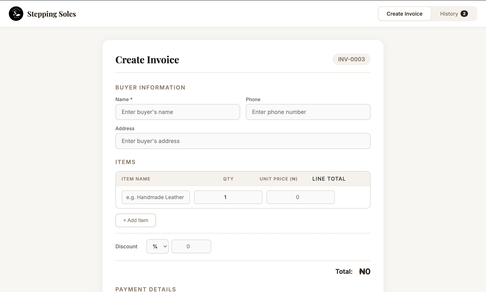

# Stepping Soles Invoice Generator

A branded invoice tool built for **Stepping Soles**, a handmade shoe business. The owner used to type every invoice by hand. Now she fills in one form and downloads a finished invoice as a PDF or an image.

**Result:** creating and sending an invoice went from about **30 minutes to about 5**.



## The problem

Every order needed an invoice, and each one was typed from scratch: buyer details, items, totals, discounts and bank details. It was slow, easy to get wrong, and there was no record of past invoices.

## What it does

- **One form for everything:** buyer name, phone and address, as many items as the order needs, and an optional discount (percentage or fixed amount)
- **Totals done for you:** line totals, discount and the final naira total update as you type
- **Payment details remembered:** the owner types her bank details once and they're saved on her device only, so they never sit in the public code
- **Branded output:** each invoice uses the Stepping Soles logo, colours and contact details, and downloads as a PDF or a PNG image
- **Numbered and saved:** invoices are numbered automatically (INV-0001, INV-0002…) and kept in a History tab, where they can be downloaded again or deleted

## Decisions I made

- **No accounts and no server.** The owner needed something she could open and use straight away. Everything runs in the browser, and invoice history is saved on her device. This kept the tool free to host and simple to use.
- **PDF and image both.** A PDF suits email and printing, and an image is quicker to share in a chat, so both are one click away.
- **The logo adapts for print.** The brand logo is white on black, so the tool inverts it automatically to keep invoices light and printable.

## Built with

React 19, Vite 7 and html2pdf.js. Built with AI coding tools, and deployed on Netlify.

## Run it yourself

```bash
npm install
npm run dev
```

## What I'd add next

- Sync invoice history to the cloud, so it isn't lost if browser data is cleared
- A share button that sends the invoice straight to WhatsApp
- A simple monthly summary of sales from past invoices

---

Built by Sharon Praise-Akpunne.
